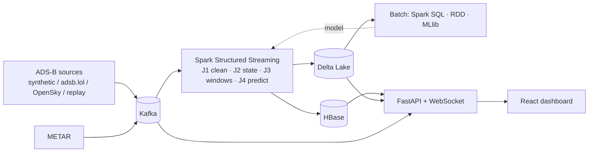

# Vimana

Real-time airspace intelligence for Indian airports. Vimana streams ADS-B aircraft telemetry and METAR
weather through Kafka and Spark Structured Streaming, keeps operational state in HBase and a Delta Lake
lakehouse, detects holding patterns and go-arounds, predicts terminal-area delay with Spark MLlib, and
shows everything on a live map dashboard.

## What it does

- **Detects** holding patterns, go-arounds, landings, departures and suspected diversions with stateful
  stream processing (`applyInPandasWithState`).
- **Measures** congestion per airport over sliding windows: traffic within 40 NM, arrivals, holds, low visibility.
- **Predicts** the additional terminal-area time of each arriving aircraft when it enters the 40 NM ring
  (Spark MLlib gradient-boosted trees, compared with median and linear baselines).
- **Discovers** standard approach paths with KMeans and flags anomalous approaches.
- **Quantifies** fuel burned and CO₂ emitted while holding.

## Architecture



Details: [docs/architecture.md](docs/architecture.md), [docs/hbase-schema.md](docs/hbase-schema.md).

## Tech stack

| Layer | Technology |
|---|---|
| Ingest | Apache Kafka 3.9 (KRaft) |
| Stream and batch processing | Apache Spark 3.5.3 (Structured Streaming, Spark SQL, MLlib, RDD) |
| Operational store | Apache HBase 2.5.10 via Thrift and happybase |
| Lakehouse | Delta Lake 3.2.1 (bronze, silver, gold) |
| ML tracking | MLflow 2.17 |
| API | FastAPI, aiokafka, deltalake |
| Frontend | React 18, TypeScript, Vite, MapLibre GL, deck.gl, Recharts |
| Runtime | Docker Compose, Python 3.11 |

## Quick start (offline)

Requires Docker with Compose v2, GNU Make and git. No API keys.

```
git clone <repo-url> vimana && cd vimana
cp .env.example .env
make up
```

Open http://localhost:8080. The synthetic simulator starts producing aircraft within about a minute.
Spark's UI is at http://localhost:4040 and the API docs at http://localhost:8000/docs.

Other targets: `make logs s=spark-streaming`, `make down`, `make reset`, `make test`, `make smoke`,
`make tools` (Kafka UI and MLflow UI), `make shell-hbase`.

Try the fog scenario: open the **Pipeline** page and press *Inject fog* for VIDP. Within a few simulated
minutes arrivals start holding (amber aircraft) and the airport's congestion score rises.

## Live data

Set `ADSB_PROVIDER` in `.env` and run `make live`:

| Provider | Setting |
|---|---|
| adsb.lol (free, no key) | `ADSB_PROVIDER=adsblol`, `ADSBLOL_POLL_S=15` |
| OpenSky | `ADSB_PROVIDER=opensky`, `OPENSKY_CLIENT_ID`, `OPENSKY_CLIENT_SECRET`; polling is paced by `OPENSKY_DAILY_CREDITS` |
| Replay of recorded data | `ADSB_PROVIDER=replay`, `REPLAY_SPEED=50` (reads `data/raw`) |

Every provider's raw messages are archived to `data/raw/<source>/<date>/<hour>.jsonl.gz`. ADS-B coverage
over India can be patchy, so the simulator remains the default.

## Building the ML model

```
make seed      # ~45 min: synthetic history at 30x with fog and load spikes, then make batch
make batch     # b01 gold tables, b02 RDD efficiency, b03 training set, b04 train, b05 clustering
make train     # only b03 + b04
```

`b04` trains a `GBTRegressor`, compares it with a per-airport median and linear regression on a held-out
final 20% of time, logs to MLflow (`make tools`, http://localhost:5000) and publishes the model to
`data/models/delay/current`. The streaming job reloads it automatically and predictions switch from
`baseline` to the new version. Results appear on the **Model** page.

## HBase schema

Six tables: `flight_track`, `flight_state`, `airspace_cell`, `airport_live`, `events`, `predictions`.
Keys are salted and use reverse timestamps; `airspace_cell` uses one dynamic column per aircraft;
`airport_live` keeps 1440 cell versions as a per-minute time series. See
[docs/hbase-schema.md](docs/hbase-schema.md).

## Course requirement coverage

| Requirement | Implementation |
|---|---|
| Semi-structured data | OpenSky positional JSON, adsb.lol nested JSON, METAR coded text |
| Streaming | Kafka topics, Spark Structured Streaming J1-J4 |
| Time series | Per-aircraft tracks, per-minute airport metrics, HBase cell versions |
| HBase wide-column | Six tables, salted keys, dynamic qualifiers, versions, TTLs, server-side filter |
| Spark RDD | `batch/b02_rdd_flight_efficiency.py`: map, filter, flatMap, groupByKey, reduceByKey, sortBy, broadcast, accumulator, actions |
| Spark SQL | `batch/b01_build_gold.py`: CTEs, window functions (LAG, rolling AVG, RANK, LEAD), range join |
| Spark ML | GBT regression with TrainValidationSplit, linear baseline, KMeans with silhouette selection |
| ETL, validation, standardisation | J1: unit conversion, schema mapping, validation rules, dead-letter queue, deduplication |
| Advanced | Stream-stream join with watermarks, `applyInPandasWithState`, H3 indexing, idempotent sinks, Delta medallion, MLflow, model hot reload |

## Project structure

```
ingest/       providers (synthetic, adsb.lol, OpenSky, replay), producers, raw archive
vimana_common/ settings, geo, units, rowkeys, METAR parser, features, schemas
streaming/    J1-J4 jobs, detectors, HBase sinks, query listener
batch/        b00-b05 jobs and their pure helpers
backend/      FastAPI app and tests
frontend/     React app
infra/        Dockerfiles for HBase, Spark, Python; Kafka topic bootstrap
scripts/      table creation, seed, smoke test, benchmark
tests/        unit tests for common code, detectors, batch helpers, providers
docs/         architecture, HBase schema, benchmarks, report
```

## Testing

```
pip install -r requirements/common.txt -r requirements/ingest.txt -r requirements/backend.txt -r requirements/dev.txt
pytest -q
cd frontend && npm ci && npm run build
make smoke        # end-to-end check against a running stack
```

Unit tests cover units, geodesy, row keys, METAR parsing, the simulator, the detectors (scripted
racetrack, straight-in and go-around trajectories), features, batch helpers, live providers and the API
(against a fake repository). The Spark jobs are exercised by `make smoke` and the batch run.

## Benchmarks

Run `python scripts/benchmark.py`; results are written to [docs/benchmarks.md](docs/benchmarks.md).

## License

MIT
