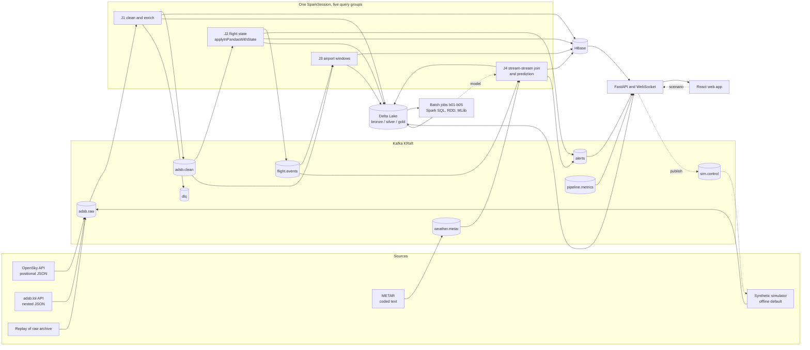

# Architecture

Vimana ingests ADS-B aircraft telemetry and METAR weather, processes it with
Spark Structured Streaming, stores operational state in HBase and a Delta Lake
lakehouse, and serves a live web application.

## Streaming jobs

| Job | Source | What it does | Sinks |
|---|---|---|---|
| J1 `j1_clean` | `adsb.raw` | Parses OpenSky and adsb.lol payloads into one schema, converts units, validates against `config/app.yaml`, drops duplicates within a 2-minute watermark, joins the nearest airport, adds H3 cells | `adsb.clean`, `dlq`, Delta bronze and silver, HBase `flight_track` and `airspace_cell`, `pipeline.metrics` |
| J1 `j1_metar` | `weather.metar` | Decodes METAR text with a pandas UDF | Delta `silver/metar`, HBase `airport_live` weather columns |
| J2 `j2_flight_state` | `adsb.clean` | Keeps one `FlightState` per aircraft and emits events | `flight.events`, `alerts`, HBase `events` and `flight_state`, Delta `silver/events` |
| J3 `j3_traffic`, `j3_events` | `adsb.clean`, `flight.events` | Sliding-window traffic, arrivals, holds, go-arounds | HBase `airport_live` (cell timestamp = window end), `airport.metrics`, `alerts`, Delta |
| J4 `j4_predict` | `flight.events`, `weather.metar` | Left-outer stream-stream join, then scores each terminal entry | HBase `predictions`, `predictions`, `alerts`, Delta |

All queries run in one SparkSession (`streaming/app.py`) to save memory. Each has its own
checkpoint under `data/checkpoints/<query>`.

## Design decisions

- **Kafka as the only integration point.** Producers, jobs and the API are decoupled by topics, so any
  component can restart independently. Keys (`icao24`, airport) keep one aircraft's records in order
  within a partition.
- **Detectors are plain Python.** `streaming/detectors.py` has no Spark imports, so holding, go-around,
  landing and diversion rules are unit tested with scripted trajectories and then reused unchanged
  inside `applyInPandasWithState`.
- **Idempotent sinks.** HBase row keys and cell timestamps derive from event time, and Delta appends use
  `txnAppId` / `txnVersion` per micro-batch, so a replayed batch does not duplicate data. Kafka sinks
  are at-least-once; the backend de-duplicates by id.
- **One feature function.** `vimana_common/features.py` builds the model features for both batch training
  and streaming scoring, which prevents training/serving skew.
- **Offline first.** `ADSB_PROVIDER=synthetic` needs no network or API keys. Live providers are optional.

## Mapping to the reference architecture

| Reference block | Vimana component |
|---|---|
| Sources | ADS-B (sensor-like), METAR text, OurAirports reference CSV |
| Ingest | Kafka KRaft |
| Stream processing | Spark Structured Streaming J1-J4 |
| Cold storage | Delta bronze, gzip JSONL raw archive |
| Analytical store | Delta silver and gold, HBase operational tables |
| Batch / ETL | `batch/b00` to `b05` |
| Machine learning | MLlib GBT regression and KMeans, MLflow |
| Monitoring and notification | `alerts` to WebSocket toasts, `pipeline.metrics` to the Pipeline page |
| Dashboards and real-time apps | React app |
