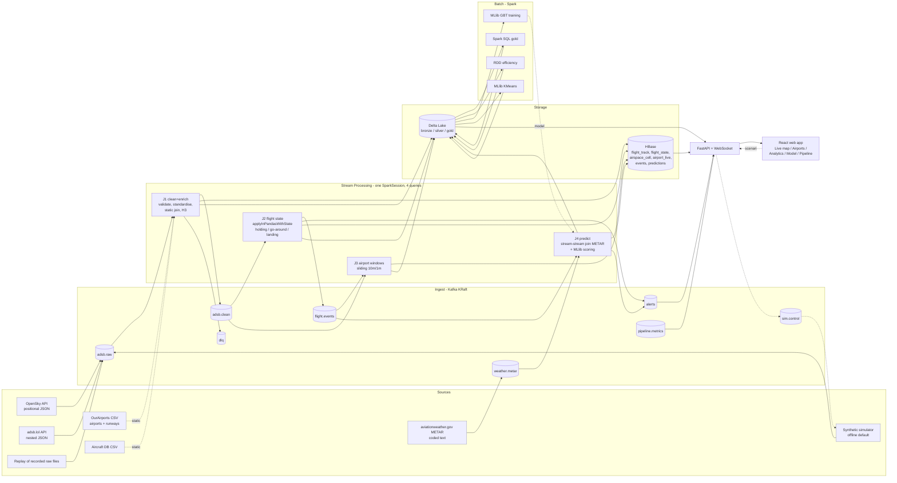

# VIMANA — Real-Time Airspace Intelligence Platform
## Complete Implementation Specification

> **Course:** Big Data and Modern Databases — Final Package (Team of 2)
> **Authors:** Sajin MK
> **Stack in one line:** Python 3.11 · Apache Kafka 3.9 (KRaft) · Apache Spark 3.5 (PySpark Structured Streaming, Spark SQL, MLlib, RDD) · Apache HBase 2.5 (wide-column, via Thrift + happybase) · Delta Lake 3.2 · FastAPI · React 18 + TypeScript + Vite + MapLibre GL + deck.gl · Docker Compose · MLflow

This document is the **single source of truth** for building Vimana end to end. It is written so that a coding agent (or a human) can build the entire system phase by phase, with no ambiguity about the tech stack, file layout, data contracts, algorithms, or acceptance criteria.

---

## 0. Instructions for the implementing agent (READ FIRST)

1. **Build in the phase order of Section 15.** Do not start a phase until the previous phase's acceptance criteria pass.
2. **Pin every version exactly as listed in Section 3.** Do not upgrade "to latest". The Spark / Delta / Kafka-connector / Python / pandas combination is chosen to be mutually compatible.
3. **The system MUST run fully offline** with `ADSB_PROVIDER=synthetic` (Section 6.4). The live providers (OpenSky, adsb.lol) are optional add-ons. A fresh clone + `make up` must produce a working dashboard with moving aircraft within ~3 minutes, with no API keys.
4. **Everything runs in Docker Compose.** No host installs other than Docker, Docker Compose v2, GNU Make, and git.
5. **Commit hygiene (mandatory, see Section 17):**
   - Commits are authored only by the repository owner's configured git identity.
   - **Never** add `Co-Authored-By:` trailers, "Generated with …" lines, AI tool names, emojis, or links to chat sessions in commit messages, PR titles, PR bodies, code comments, or docs.
   - Use Conventional Commits. One logical change per commit. Commit at the end of every sub-step that leaves the repo in a working state.
   - Create `.claude/settings.json` exactly as shown in Section 17.2 as the first commit-related step.
6. Write clean, typed Python (type hints everywhere, `ruff` clean), docstrings on public functions, and unit tests for every pure function (parsers, rowkeys, detectors, feature builders).
7. When something in this spec turns out to be wrong at build time (e.g., an external API changed), fix it in the code **and** update the relevant section of this file in the same commit.
8. Never commit secrets. `.env` is git-ignored; `.env.example` is committed.

---

## 1. Problem Statement

Major Indian airports (Delhi VIDP, Mumbai VABB, Bengaluru VOBL, Chennai VOMM, Hyderabad VOHS, Kolkata VECC) routinely put arriving aircraft into **holding patterns**, and winter fog at Delhi causes **go-arounds and diversions**. Every minute of airborne holding burns fuel and emits CO₂, yet this congestion is invisible to the public and rarely quantified in real time.

**Vimana** ingests live (or replayed / simulated) ADS-B aircraft telemetry together with live aviation weather (METAR), fuses them in real time with Spark Structured Streaming, stores operational state in a wide-column HBase schema, and:

1. **Detects** holding patterns, go-arounds, landings and suspected diversions as they happen (stateful stream processing).
2. **Measures** per-airport congestion over sliding windows (traffic in the terminal area, arrival rate, aircraft holding, low-visibility flag).
3. **Predicts** the *terminal-area additional time* for each arriving aircraft at the moment it enters the 40 NM ring (Spark MLlib GBT regression; modelled on the ICAO/Eurocontrol "ASMA additional time" KPI).
4. **Discovers** standard approach paths and flags anomalous approaches (MLlib KMeans on resampled trajectories).
5. **Quantifies** fuel burned and CO₂ emitted due to holding.
6. Serves everything through a **real-time web application** (live map, airport pages, analytics, model page, pipeline health page).

---

## 2. Requirement Coverage Matrix

| Course requirement | Where it is implemented |
|---|---|
| Semi-structured data | OpenSky positional JSON arrays, adsb.lol nested JSON, METAR coded text strings (Sec 6, 8.1) |
| Streaming data | Kafka topics + Spark Structured Streaming jobs J1–J4 (Sec 7, 8) |
| Time-series data | Per-aircraft 5–10 s position series; per-airport per-minute metrics; HBase cell versions (Sec 9) |
| HBase / wide-column model | 6 tables, salted rowkeys, dynamic column qualifiers, cell versioning, TTLs, server-side filters (Sec 9) |
| Apache Spark | Structured Streaming, Spark SQL, MLlib, RDD API (Sec 8, 10, 11) |
| Kafka | 9 topics, KRaft single broker, keyed partitioning, DLQ (Sec 7) |
| Python | All producers, Spark jobs, backend (Sec 3) |
| ETL pipelines, data mapping & integration | 4 sources normalised into one canonical schema; static + stream-stream joins (Sec 8) |
| Standardisation, sorting, aggregation, validation, verification | Unit conversion, dedup, bounds checks, DLQ, sliding windows, sorted trajectories, data-quality metrics (Sec 8.1, 8.6) |
| Spark RDD transformations & actions | `b02_rdd_flight_efficiency.py` — map, filter, groupByKey, flatMap, reduceByKey, sortBy, broadcast, accumulator, count/take/takeOrdered/collect (Sec 10.2) |
| Spark SQL | Gold tables with window functions, CTEs, ranking (Sec 10.1) |
| Spark ML | GBTRegressor + baselines + TrainValidationSplit; KMeans + silhouette (Sec 11) |
| Real-time processing | J1–J4 run continuously; live dashboard over WebSocket (Sec 8, 12, 13) |
| ML model / analytics | Delay prediction, approach clustering, CO₂ analytics (Sec 11, 10) |
| Reference architecture (Ingest → Stream Processing → Cold storage / Analytical store → ML / Monitoring / Dashboards / Real-time apps) | Sec 4 diagram maps 1:1 |
| **Advanced (beyond brief)** | Stream-stream join with watermarks, `applyInPandasWithState` arbitrary stateful processing, H3 geospatial indexing, idempotent exactly-once-effective sinks, Delta medallion lakehouse, MLflow tracking, model hot-reload, StreamingQueryListener telemetry, replay benchmarks, synthetic scenario injection |

---

## 3. Tech Stack (pinned versions)

### 3.1 Infrastructure

| Component | Version | Image / source | Purpose |
|---|---|---|---|
| Docker Engine + Compose v2 | ≥ 24 / ≥ 2.20 | host | Orchestration |
| Apache Kafka | **3.9.0** | `apache/kafka:3.9.0` (official, KRaft mode, no ZooKeeper) | Ingest log |
| Apache HBase | **2.5.10** | custom `infra/hbase/Dockerfile` built FROM `eclipse-temurin:11-jre-jammy`, tarball from `https://archive.apache.org/dist/hbase/2.5.10/hbase-2.5.10-bin.tar.gz` | Operational wide-column store (standalone mode + Thrift1 server) |
| Apache Spark | **3.5.3** | via `pyspark==3.5.3` in custom image FROM `python:3.11-slim-bookworm` + `openjdk-17-jre-headless` | Streaming, SQL, ML, RDD |
| Spark Kafka connector | `org.apache.spark:spark-sql-kafka-0-10_2.12:3.5.3` | Maven via `spark.jars.packages` (Ivy cache volume) | Kafka source/sink |
| Delta Lake | **3.2.1** | `delta-spark==3.2.1` (+ `configure_spark_with_delta_pip`) | Bronze/silver/gold lakehouse |
| MLflow | **2.17.2** | pip; file store `./mlruns`; UI container (profile `tools`) | Experiment tracking |
| Kafka UI (optional) | latest `provectuslabs/kafka-ui:v0.7.2` | profile `tools` | Demo/debug |
| Nginx | `nginx:1.27-alpine` | frontend container | Serve SPA + reverse proxy `/api`, `/ws` |

> Note: Bitnami Kafka/Spark images are **not** used (their free catalog was withdrawn). Use only the images above.

### 3.2 Python (3.11) libraries

```
# requirements/common.txt
pydantic==2.9.2
pydantic-settings==2.6.1
pyyaml==6.0.2
orjson==3.10.11
structlog==24.4.0
h3==4.1.2              # v4 API: latlng_to_cell, cell_to_boundary
numpy==1.26.4
pandas==2.1.4
pyarrow==14.0.2

# requirements/ingest.txt   (producers)
-r common.txt
confluent-kafka==2.6.1
httpx==0.27.2
tenacity==9.0.0
python-metar==1.4.0     # module name: metar  (from metar import Metar)

# requirements/spark.txt    (streaming + batch)
-r common.txt
pyspark==3.5.3
delta-spark==3.2.1
happybase==1.2.0
thriftpy2==0.5.2
mlflow==2.17.2
confluent-kafka==2.6.1
python-metar==1.4.0

# requirements/backend.txt
-r common.txt
fastapi==0.115.4
uvicorn[standard]==0.32.0
happybase==1.2.0
thriftpy2==0.5.2
aiokafka==0.12.0
deltalake==0.17.4       # delta-rs reader (0.21 needs pyarrow>=16, conflicts with pinned 14) for gold tables (no JVM needed)
duckdb==1.1.3

# requirements/dev.txt
pytest==8.3.3
pytest-cov==6.0.0
ruff==0.7.3
mypy==1.13.0
httpx==0.27.2
```

### 3.3 Frontend

| Library | Version | Purpose |
|---|---|---|
| Node.js | 20 LTS (build stage only) | Build |
| React | 18.3 | UI |
| TypeScript | 5.6 | Types |
| Vite | 5.4 | Bundler |
| react-router-dom | 6.28 | Routing |
| @tanstack/react-query | 5.59 | Server state, polling |
| zustand | 5.0 | Live WebSocket state |
| maplibre-gl | 4.7 | Base map (no API key) |
| react-map-gl | 7.1 (`react-map-gl/maplibre`) | React bindings |
| deck.gl (`@deck.gl/react`, `@deck.gl/layers`, `@deck.gl/geo-layers`) | 9.0 | Aircraft IconLayer, PathLayer, H3HexagonLayer |
| recharts | 2.13 | Charts |
| tailwindcss | 3.4 | Styling |
| lucide-react | 0.454 | Icons |
| date-fns | 4.1 | Time formatting |

Base map style: `https://tiles.openfreemap.org/styles/liberty` (free, no key). Fallback: `https://demotiles.maplibre.org/style.json` (configurable via `VITE_MAP_STYLE_URL`).

### 3.4 Host requirements

- 8 GB RAM free for Docker (16 GB machine recommended), 4 CPU cores, 15 GB disk.
- Works on Linux, macOS (Intel/Apple Silicon), Windows 11 + WSL2.

---

## 4. Architecture



**Mapping to the reference architecture in the brief:**

| Reference block | Vimana component |
|---|---|
| Sources (structured / IoT / clickstream) | ADS-B transponders (IoT-like sensors), METAR, OurAirports/aircraft DB (structured) |
| Ingest (scalable partitioned log) | Kafka 3.9 KRaft |
| Stream processing | Spark Structured Streaming J1–J4 |
| Cold storage (raw for archival) | Delta bronze + gzip JSONL raw archive |
| Analytical data store | Delta silver/gold + HBase operational tables |
| Batch jobs / ETL pipelines | `batch/b01…b05` |
| Machine Learning | MLlib GBT + KMeans, MLflow |
| Monitoring & Notification | `alerts` topic → WebSocket toasts; `pipeline.metrics` → Pipeline page |
| Reporting & Visualisation | React Analytics / Airport / Model pages |
| Real-time apps | React Live map over WebSocket |

---

## 5. Repository Layout

```
vimana/
├── README.md
├── implementation.md                # this file
├── LICENSE                          # MIT
├── Makefile
├── docker-compose.yml
├── .env.example
├── .gitignore
├── .gitattributes
├── .claude/settings.json            # see Sec 17.2
├── .github/workflows/ci.yml
├── pyproject.toml                   # ruff, mypy, pytest config
├── requirements/{common,ingest,spark,backend,dev}.txt
├── config/
│   ├── airports.yaml                # monitored airports + capacities
│   ├── fuel_burn.yaml               # holding fuel flow per aircraft category
│   └── app.yaml                     # thresholds (holding, go-around, windows)
├── infra/
│   ├── hbase/{Dockerfile,hbase-site.xml,entrypoint.sh}
│   ├── spark/Dockerfile
│   ├── python/Dockerfile            # ingest + backend base
│   └── kafka/create-topics.sh
├── vimana_common/                   # shared Python package (installed in every image)
│   ├── __init__.py
│   ├── settings.py                  # pydantic-settings, reads env + config/*.yaml
│   ├── schemas.py                   # canonical record dataclasses + Spark StructTypes
│   ├── geo.py                       # haversine, bearing, ENU, heading diff, H3 helpers
│   ├── units.py                     # m↔ft, m/s↔kt, m/s↔fpm
│   ├── rowkeys.py                   # HBase rowkey builders (salt, reverse ts)
│   ├── hbase_client.py              # happybase pool + helpers
│   ├── metar_parse.py               # METAR decode → dict
│   ├── airports.py                  # load OurAirports + config/airports.yaml
│   ├── fuel.py                      # fuel & CO2 estimates
│   └── logging.py
├── ingest/
│   ├── providers/
│   │   ├── base.py                  # Provider protocol
│   │   ├── opensky.py               # OAuth2 client-credentials + credit budget
│   │   ├── adsblol.py
│   │   ├── synthetic.py             # flight simulator (Sec 6.4)
│   │   └── replay.py
│   ├── adsb_producer.py             # main loop → adsb.raw + raw archive
│   ├── metar_producer.py            # → weather.metar (+ synthetic weather)
│   └── recorder.py                  # gzip JSONL archive writer
├── streaming/
│   ├── app.py                       # builds SparkSession, starts J1–J4, listener
│   ├── spark_session.py
│   ├── j1_clean_enrich.py
│   ├── j2_flight_state.py
│   ├── j3_airport_windows.py
│   ├── j4_predict.py
│   ├── sinks/hbase_sink.py          # foreachPartition writers
│   ├── detectors.py                 # pure-Python holding/go-around/phase logic
│   └── listener.py                  # StreamingQueryListener → pipeline.metrics
├── batch/
│   ├── b00_bootstrap_static.py      # download OurAirports + aircraft DB → Delta
│   ├── b01_build_gold.py            # Spark SQL
│   ├── b02_rdd_flight_efficiency.py # RDD API
│   ├── b03_build_training_set.py
│   ├── b04_train_delay_model.py     # MLlib GBT + MLflow
│   └── b05_cluster_approaches.py    # MLlib KMeans
├── scripts/
│   ├── hbase_create_tables.py
│   ├── wait_for.sh
│   ├── smoke_test.sh
│   ├── benchmark.py
│   └── seed_history.sh              # run synthetic at high speed to build training data
├── backend/
│   ├── app/
│   │   ├── main.py
│   │   ├── deps.py
│   │   ├── routers/{aircraft,airports,events,predictions,analytics,model,pipeline,sim,health}.py
│   │   ├── services/{hbase_repo.py,gold_repo.py,live_hub.py,kafka_consumers.py,congestion.py}
│   │   └── models.py               # pydantic response models
│   └── tests/
├── frontend/
│   ├── Dockerfile                   # node build → nginx
│   ├── nginx.conf
│   ├── index.html
│   ├── package.json
│   ├── vite.config.ts
│   ├── tailwind.config.js
│   └── src/
│       ├── main.tsx, App.tsx, api.ts, ws.ts, store.ts, types.ts
│       ├── pages/{LiveMap,AirportDetail,Analytics,ModelPage,Pipeline}.tsx
│       └── components/{TopBar,AircraftPanel,AlertToasts,CongestionGauge,MetarCard,KpiCard,SimControls}.tsx
├── tests/                           # unit tests for vimana_common, detectors, parsers
├── data/                            # git-ignored: raw archive, delta, checkpoints, models
└── docs/
    ├── architecture.md
    ├── hbase-schema.md
    ├── benchmarks.md
    └── report/                      # final report sections for submission
```

---

## 6. Data Sources & Providers

All monitored airports are configured in `config/airports.yaml`:

```yaml
# Geo values are seeds; b00_bootstrap_static.py overwrites lat/lon/elevation from OurAirports.
airports:
  - icao: VIDP  # Delhi
    name: Indira Gandhi Intl
    lat: 28.5665
    lon: 77.1031
    elev_ft: 777
    capacity_per_10min: 12    # arrivals the terminal area handles comfortably per 10 min
  - icao: VABB  # Mumbai
    name: Chhatrapati Shivaji Maharaj Intl
    lat: 19.0887
    lon: 72.8679
    elev_ft: 39
    capacity_per_10min: 8
  - icao: VOBL  # Bengaluru
    name: Kempegowda Intl
    lat: 13.1986
    lon: 77.7066
    elev_ft: 3000
    capacity_per_10min: 9
  - icao: VOMM  # Chennai
    name: Chennai Intl
    lat: 12.9941
    lon: 80.1709
    elev_ft: 52
    capacity_per_10min: 6
  - icao: VOHS  # Hyderabad
    name: Rajiv Gandhi Intl
    lat: 17.2313
    lon: 78.4299
    elev_ft: 2024
    capacity_per_10min: 6
  - icao: VECC  # Kolkata
    name: Netaji Subhas Chandra Bose Intl
    lat: 22.6547
    lon: 88.4467
    elev_ft: 16
    capacity_per_10min: 5
terminal_radius_nm: 40
outer_radius_nm: 100
```

### 6.1 Provider: OpenSky Network (live, optional)

- Endpoint: `GET https://opensky-network.org/api/states/all?lamin=..&lomin=..&lamax=..&lomax=..&extended=1`
- Auth: OAuth2 client-credentials. Token URL: `https://auth.opensky-network.org/auth/realms/opensky-network/protocol/openid-connect/token` (`grant_type=client_credentials`, `client_id`, `client_secret` from `.env`). Cache the token until ~60 s before expiry. *Verify against OpenSky's current API docs at build time and update this section if it changed.*
- Rate limits are credit-based and depend on bounding-box area. Implement a **CreditBudget** class: configurable `OPENSKY_DAILY_CREDITS` (default 4000) and `OPENSKY_CREDITS_PER_CALL` (default 1 for a ±1.5° box). The poller computes the poll interval per airport as `86400 * n_airports * credits_per_call / daily_credits` seconds (min 10 s) and backs off on HTTP 429 using `X-Rate-Limit-Retry-After-Seconds` if present.
- Poll one small box per airport: `lat±1.5°, lon±1.5°`.
- State vector is a **positional array**. Indices (0-based): `0 icao24, 1 callsign, 2 origin_country, 3 time_position, 4 last_contact, 5 longitude, 6 latitude, 7 baro_altitude (m), 8 on_ground, 9 velocity (m/s), 10 true_track (deg), 11 vertical_rate (m/s), 12 sensors, 13 geo_altitude (m), 14 squawk, 15 spi, 16 position_source, 17 category`.
- Coverage over India can be patchy — check on day one; adsb.lol is the alternate.

### 6.2 Provider: adsb.lol (live, optional, no key)

- Endpoint: `GET https://api.adsb.lol/v2/point/{lat}/{lon}/{radius_nm}` (radius ≤ 250).
- Response: `{"ac":[{hex, flight, lat, lon, alt_baro (ft or "ground"), alt_geom, gs (kt), track, baro_rate (fpm), squawk, t (type), r (reg), seen_pos, ...}], "now": <ms>}`.
- Poll each airport every 15 s (configurable `ADSBLOL_POLL_S`), be polite (User-Agent `vimana-student-project/1.0`).

### 6.3 Provider: Replay

- Reads `data/raw/{source}/{YYYY-MM-DD}/{HH}.jsonl.gz` in chronological order and republishes to `adsb.raw` honouring original inter-message gaps divided by `REPLAY_SPEED` (default 50). Rewrites `fetched_at` to "now" and stores original in `orig_fetched_at`, so streaming watermarks behave.

### 6.4 Provider: Synthetic simulator (DEFAULT — must always work)

A deterministic-seedable flight simulator in `ingest/providers/synthetic.py` that emits **OpenSky-shaped** payloads (same positional array) with `source="synthetic"`.

Simulation clock: `SIM_SPEED` (default 1.0 = real time; `seed_history.sh` uses 30).

Per airport, every simulated minute spawn arrivals with Poisson rate `λ = capacity_per_10min / 10 * load_factor` (load factor follows a daily curve: low 01–05 h, peaks 07–10 h and 18–22 h IST). Each arrival:

1. **Spawn** at 120 NM on a random bearing chosen from 4–6 "arrival corridors" per airport (corridor bearings fixed per airport, ±8° jitter), cruise FL300–FL370, GS 440–480 kt. Callsign = random airline prefix (`AIC, IGO, VTI, AKJ, SEJ, AXB, IAD, QTR, UAE, SIA`) + 3–4 digits; icao24 = random 6-hex, aircraft category from weighted mix (narrowbody 80 %, widebody 15 %, regional 5 %).
2. **Descend** linearly to cross 40 NM at ~10 000 ft and 280 kt, then follow the corridor to an Initial Approach Fix 15 NM out on the extended runway centreline.
3. **Holding** (probability `p_hold = clip(0.05 + 0.6*max(0, traffic/capacity - 0.8) + 0.4*fog, 0, 0.9)`): fly a racetrack at a holding fix 20–30 NM out: 1-minute legs, standard-rate turns (3°/s), level at 7000–11000 ft, 210–230 kt, right turns, for N laps (1–6, more under fog/congestion).
4. **Approach & land**: 3° glide path on runway heading (from runways.csv; fallback 090/270), touchdown, `on_ground=true`, decelerate to 30 kt, despawn after 2 min on ground.
5. **Go-around** (probability 0.01, ×8 when fog): at 300–800 ft AGL climb +1500 fpm to 3000 ft, fly a circuit, re-approach. Under heavy fog (visibility < 300 m) with probability 0.3 after 2 holds: **divert** to another configured airport (climb, head off, despawn at 120 NM).
6. **Departures**: spawn on ground, take off on runway heading, climb out to 120 NM, despawn (they create traffic but are excluded from arrival metrics).

Each aircraft emits a state every 5 s of sim time, with Gaussian noise (σ 30 m position, σ 25 ft altitude, σ 2 kt speed, σ 1° track) and 2 % random message drop and 0.5 % duplicates and 0.2 % corrupted records (out-of-range lat, null icao24) — so validation and DLQ have something to do.

**Scenario control:** the simulator consumes topic `sim.control` messages `{"action":"set_fog","airport":"VIDP","visibility_m":200,"duration_min":60}`, `{"action":"set_load","airport":"VABB","load_factor":1.6}`, `{"action":"reset"}`. The METAR producer reads the same scenario state (shared via the same topic) so synthetic METARs show fog.

### 6.5 Weather: METAR

- Live: `GET https://aviationweather.gov/api/data/metar?ids=VIDP,VABB,VOBL,VOMM,VOHS,VECC&format=json` every 10 min. Publish one message per station: `{"station","obs_time","raw","source":"awc","fetched_at"}` keyed by station.
- Synthetic (`WEATHER_PROVIDER=synthetic`, default when `ADSB_PROVIDER=synthetic`): generate realistic METAR strings every 30 sim-minutes, e.g. `VIDP 190530Z 27006KT 0200 FG VV001 12/11 Q1018 NOSIG` under fog, otherwise `VOMM 190530Z 09010KT 6000 FEW020 30/24 Q1008 NOSIG`.
- Parsing in `vimana_common/metar_parse.py` with `python-metar`, plus regex fallback. Output fields: `station, obs_ts, wind_dir_deg, wind_kt, gust_kt, visibility_m, ceiling_ft (lowest BKN/OVC/VV), temp_c, dew_c, qnh_hpa, wx_codes (list), fog (bool), low_vis (visibility_m < 1500), flight_category (VFR/MVFR/IFR/LIFR)`. Unparseable → DLQ.

### 6.6 Static reference data (`batch/b00_bootstrap_static.py`)

- OurAirports: `https://davidmegginson.github.io/ourairports-data/airports.csv` and `runways.csv` → Delta `silver/ref_airports`, `silver/ref_runways`, filtered to `iso_country='IN'` plus configured airports.
- Aircraft DB (optional): OpenSky aircraft metadata CSV if reachable; else skip. Fallback category from adsb.lol `t` type code or synthetic category; else from callsign heuristics (default `narrowbody`).
- If the machine is offline, fall back to `config/airports.yaml` and default runways `(09/27)` so the system still runs.

`config/fuel_burn.yaml` (approximate holding fuel flow, documented as approximations):

```yaml
holding_fuel_kg_per_min:
  regional: 20
  narrowbody: 40
  widebody: 100
co2_per_kg_fuel: 3.16
```

---

## 7. Kafka Design

Single broker, KRaft (`apache/kafka:3.9.0`). Topics created by `infra/kafka/create-topics.sh` run in a one-shot `kafka-init` container.

| Topic | Partitions | Key | Retention | Payload |
|---|---|---|---|---|
| `adsb.raw` | 6 | airport or icao24 | 24 h | provider-native JSON envelope (6.7) |
| `weather.metar` | 1 | station | 7 d | METAR envelope |
| `adsb.clean` | 6 | icao24 | 24 h | canonical position JSON |
| `flight.events` | 3 | icao24 | 7 d | event JSON |
| `airport.metrics` | 3 | airport | 3 d | window metrics JSON |
| `predictions` | 3 | icao24 | 7 d | prediction JSON |
| `alerts` | 1 | airport | 3 d | alert JSON |
| `dlq` | 1 | source | 7 d | `{source, reason, raw, ts}` |
| `pipeline.metrics` | 1 | query name | 1 d | streaming progress JSON |
| `sim.control` | 1 | — | 1 d | scenario commands |

Listeners: `PLAINTEXT://kafka:9092` (internal), `EXTERNAL://localhost:29092` (host), `CONTROLLER://kafka:9093`.

### 6.7 / 7.1 Message envelopes

`adsb.raw` (one message per aircraft state to keep partitions balanced):

```json
{"source":"opensky","fetched_at":1760869200123,"airport_hint":"VIDP",
 "state":["800c4a","AIC101  ","India",1760869195,1760869199,77.21,28.61,3048.0,false,128.6,271.3,-5.2,null,3100.0,"4521",false,0,4]}
```
```json
{"source":"adsblol","fetched_at":1760869200123,"airport_hint":"VOMM",
 "ac":{"hex":"800d11","flight":"IGO6E21 ","lat":12.9,"lon":80.3,"alt_baro":4500,"gs":210.0,"track":95.0,"baro_rate":-800,"t":"A20N","seen_pos":0.4}}
```

`adsb.clean` canonical record (all units standardised):

```json
{"icao24":"800c4a","callsign":"AIC101","ts":1760869195000,"fetched_at":1760869200123,
 "lat":28.61,"lon":77.21,"alt_ft":10000,"alt_agl_ft":9223,"gs_kt":250.0,"track_deg":271.3,
 "vr_fpm":-1024,"on_ground":false,"category":"narrowbody","source":"opensky",
 "airport":"VIDP","dist_nm":6.2,"bearing_from_apt":312.4,"h3_r5":"85...","h3_r7":"87..."}
```

`flight.events`:

```json
{"event_id":"VIDP|800c4a|1760869195000|HOLDING_START","type":"HOLDING_START",
 "icao24":"800c4a","callsign":"AIC101","airport":"VIDP","ts":1760869195000,
 "details":{"fix_lat":28.8,"fix_lon":77.0,"alt_ft":9000,"turn_deg":372}}
```

Event types: `ENTERED_TERMINAL, HOLDING_START, HOLDING_END, GO_AROUND, LANDED, DIVERSION_SUSPECTED, DEPARTED`.
`LANDED.details` includes `entry_ts, entry_bearing, transit_min, holding_min, extra_fuel_kg, extra_co2_kg`.
`ENTERED_TERMINAL.details` includes `entry_bearing, alt_ft, gs_kt, category`.

---

## 8. Stream Processing (Spark Structured Streaming)

All four queries run in **one SparkSession** (`streaming/app.py`) to save memory, each with its own checkpoint under `/data/checkpoints/{query}`. `spark.sql.shuffle.partitions=6`, `spark.sql.session.timeZone=UTC`, `spark.streaming.stopGracefullyOnShutdown=true`. Trigger `processingTime="5 seconds"` (J3: `"10 seconds"`).

SparkSession builder:

```python
from delta import configure_spark_with_delta_pip
from pyspark.sql import SparkSession

def build_spark(app_name: str) -> SparkSession:
    builder = (
        SparkSession.builder.appName(app_name)
        .master("local[4]")
        .config("spark.sql.extensions", "io.delta.sql.DeltaSparkSessionExtension")
        .config("spark.sql.catalog.spark_catalog", "org.apache.spark.sql.delta.catalog.DeltaCatalog")
        .config("spark.sql.shuffle.partitions", "6")
        .config("spark.sql.session.timeZone", "UTC")
        .config("spark.driver.memory", "2g")
        .config("spark.jars.ivy", "/opt/ivy")
        .config("spark.sql.streaming.stateStore.providerClass",
                "org.apache.spark.sql.execution.streaming.state.RocksDBStateStoreProvider")
    )
    return configure_spark_with_delta_pip(
        builder, extra_packages=["org.apache.spark:spark-sql-kafka-0-10_2.12:3.5.3"]
    ).getOrCreate()
```

### 8.1 J1 — Clean, validate, standardise, enrich (`j1_clean_enrich.py`)

Source: `adsb.raw` (`startingOffsets=latest`, `maxOffsetsPerTrigger=50000`, `failOnDataLoss=false`).

Steps:
1. **Parse semi-structured payloads per source.** Use `get_json_object(value, '$.state[6]')` etc. for OpenSky/synthetic positional arrays (robust to mixed JSON types), and `from_json` with a struct schema for adsb.lol `ac`. Map both into the canonical columns, then `unionByName`.
2. **Standardise units:** m→ft (×3.28084), m/s→kt (×1.943844), m/s→fpm (×196.8504); adsb.lol already ft/kt/fpm; `alt_baro=="ground"` → `on_ground=true, alt_ft=elev`. Trim/upper callsign. `ts` = `time_position*1000` (OpenSky) or `fetched_at - seen_pos*1000` (adsb.lol).
3. **Validate** (rules in `config/app.yaml`): icao24 matches `^[0-9a-f]{6}$`; lat ∈ [-90,90], lon ∈ [-180,180]; within India bbox lat 0–40, lon 60–100; alt_ft ∈ [-1500, 60000]; gs_kt ∈ [0, 750]; ts not older than 10 min vs fetched_at and not > 30 s in the future. Failing rows → `dlq` with reason (via a separate write of the invalid DataFrame in the same `foreachBatch`).
4. **Deduplicate:** `withWatermark("event_time","2 minutes").dropDuplicatesWithinWatermark(["icao24","ts"])` (Spark 3.5 API).
5. **Enrich via static join:** broadcast-join the airports DataFrame; compute nearest configured airport (cross join with 6 airports is cheap — compute haversine to each, pick min with `F.array_min` over a struct array), `dist_nm`, `bearing_from_apt`, `alt_agl_ft = alt_ft - elev_ft`. Rows with nearest `dist_nm > outer_radius_nm` keep `airport=null`.
6. **Geospatial indexing:** pandas UDF using `h3.latlng_to_cell(lat, lon, 5)` and `7`.
7. **Sinks** (single `foreachBatch`):
   - `adsb.clean` (Kafka, key icao24)
   - Delta `bronze/adsb_raw` (raw `value` + metadata, append) and `silver/tracks` (canonical, append, partitioned by `date`, `airport`)
   - HBase `flight_track` and `airspace_cell` via `df.foreachPartition(write_tracks_partition)` (one happybase connection per partition, `table.batch(batch_size=1000)`)
   - Data-quality counters (valid, invalid by reason, duplicates dropped) and end-to-end latency p50/p95 (`now - fetched_at`) published to `pipeline.metrics`.

Also in J1's session: a small query `weather.metar → parse (pandas UDF using metar_parse) → silver/metar Delta + HBase airport_live wx columns`. The parsed METAR stream is also exposed as a streaming DataFrame used by J4.

### 8.2 J2 — Per-flight stateful processing (`j2_flight_state.py`)

Source: `adsb.clean`. `withWatermark("event_time", "2 minutes")` → `groupBy("icao24").applyInPandasWithState(...)`, output mode `append`, timeout `GroupStateTimeout.EventTimeTimeout`.

```python
from pyspark.sql.streaming.state import GroupState, GroupStateTimeout

def update_flight(key: tuple[str], pdfs: Iterator[pd.DataFrame], state: GroupState) -> Iterator[pd.DataFrame]:
    if state.hasTimedOut:
        st = FlightState.from_tuple(state.get)
        state.remove()
        yield emit(st.finalise_lost())         # e.g., DIVERSION_SUSPECTED if it had been holding & vanished far away
        return
    st = FlightState.from_tuple(state.get) if state.exists else FlightState.new(key[0])
    rows = pd.concat(list(pdfs)).sort_values("ts")   # sorting per flight
    out = []
    for r in rows.itertuples():
        out.extend(st.step(r))                  # pure-Python detector, see detectors.py
    state.update(st.to_tuple())
    state.setTimeoutTimestamp(int(st.last_ts) + 15 * 60 * 1000)
    yield pd.DataFrame(out, columns=OUTPUT_COLS)
```

`FlightState` (stored as a compact tuple; trajectory buffer is a JSON string of the last 15 min of points, max 200 points): `icao24, callsign, category, phase, airport, last_ts, entered_terminal_ts, entry_bearing, holding_active, holding_start_ts, holding_total_ms, min_agl_near_rwy_ft, approach_armed, buffer_json`.

Output rows have `kind ∈ {"event","state"}` — every micro-batch emits one `state` snapshot per updated flight plus zero or more `event`s.

**Detector rules (`streaming/detectors.py`, all thresholds in `config/app.yaml`, all unit-tested):**

| Detection | Rule |
|---|---|
| Phase | `GROUND` if on_ground; `APPROACH` if dist ≤ 40 NM and vr < -300 fpm and alt_agl < 12 000; `CLIMB` vr > +500; `DESCENT` vr < -500; else `CRUISE`. `HOLDING` overrides while holding active. |
| ENTERED_TERMINAL | first crossing from dist > 40 NM to ≤ 40 NM while descending or below FL150 (inbound). Records `entry_ts`, `entry_bearing`. |
| HOLDING_START | over a sliding 6-min buffer within 5–60 NM of airport: cumulative signed heading change ≥ 330° (heading diff = `((h2 - h1 + 540) % 360) - 180`), altitude range ≤ 600 ft, gs ≤ 280 kt, and buffer bounding radius ≤ 8 NM. |
| HOLDING_END | holding active and no cumulative turn ≥ 120° in last 4 min, or aircraft descends > 1500 ft below hold altitude toward the airport. Adds duration to `holding_total_ms`. |
| GO_AROUND | approach_armed (alt_agl < 1500 ft within 5 NM), then alt rises ≥ 800 ft above the minimum with vr > +500 fpm while still ≤ 8 NM and not on ground. |
| LANDED | on_ground or (alt_agl < 200 ft and gs < 80 kt) within 3 NM. Emits `transit_min = (ts - entered_terminal_ts)/60000`, `holding_min`, `extra_fuel_kg = holding_min * fuel_rate[category]`, `extra_co2_kg = extra_fuel_kg * 3.16`. |
| DIVERSION_SUSPECTED | after ENTERED_TERMINAL at airport A: either lands within 3 NM of another airport B, or climbs above FL150 and leaves > 60 NM from A without LANDED. |
| DEPARTED | was GROUND, now airborne climbing within 10 NM. |

**Sinks** (`foreachBatch`): events → `flight.events` + HBase `events` + Delta `silver/events`; holding/go-around/diversion events → also `alerts`; state snapshots → HBase `flight_state`.

### 8.3 J3 — Sliding-window airport metrics (`j3_airport_windows.py`)

Two aggregations, both writing **the same HBase row with explicit cell timestamps = window end**, so HBase cell versions form the per-minute time series and late updates of the same window overwrite the same version (idempotent):

A. From `adsb.clean` (airborne, `dist_nm ≤ 40`):
```python
(clean.withWatermark("event_time", "2 minutes")
  .groupBy(F.window("event_time", "10 minutes", "1 minute"), "airport")
  .agg(F.approx_count_distinct("icao24").alias("traffic_40nm"),
       F.approx_count_distinct(F.when(F.col("alt_agl_ft") < 5000, F.col("icao24"))).alias("low_alt_count"),
       F.avg("gs_kt").alias("avg_gs_kt"),
       F.count("*").alias("msg_count")))
```
B. From `flight.events`: `window(15 min, 1 min)` counts of `LANDED` (arrival rate), `HOLDING_START`, `GO_AROUND`.

Output mode `update`; in `foreachBatch` write HBase `airport_live` columns `c:traffic_40nm`, `c:low_alt_count`, `c:avg_gs_kt`, `c:arrivals_15m`, `c:holds_15m`, `c:go_arounds_15m` with `timestamp=window_end_ms`; also publish to `airport.metrics` and append to Delta `silver/airport_metrics`. If `traffic_40nm > capacity_per_10min * 1.5` or `holds_15m ≥ 3` → publish `alerts` (`CONGESTION`).

### 8.4 J4 — Stream-stream join with weather + live prediction (`j4_predict.py`)

```python
entries = (events.filter(F.col("type") == "ENTERED_TERMINAL")
           .withWatermark("event_time", "10 minutes").alias("e"))
wx = (metar_parsed.withWatermark("obs_time", "3 hours").alias("w"))

joined = entries.join(
    wx,
    F.expr("""
        e.airport = w.station AND
        w.obs_time BETWEEN e.event_time - INTERVAL 90 MINUTES AND e.event_time
    """),
    "leftOuter",
)
```

- Left-outer so an entry without recent weather still produces a prediction (weather features imputed; `wx_missing=1`). Left-outer rows for unmatched entries are emitted when the watermark passes; this is expected and documented.
- In `foreachBatch`: keep the latest METAR per `event_id` (window `row_number` over `obs_time desc`); fetch current congestion features for each airport from HBase `airport_live` (latest version); assemble the feature vector exactly as in Sec 11.1; score with the current `PipelineModel` loaded from `/data/models/delay/current` (hot-reloaded when the `_SUCCESS` file mtime changes). If no model exists yet, use the **baseline predictor** (per-airport median of historical `additional_min`, default 4.0) and tag `model_version="baseline"`.
- Sinks: HBase `predictions`, Kafka `predictions`, Delta `silver/predictions`. Alert if `predicted_additional_min ≥ 10`.
- When the matching `LANDED` event arrives, the backend joins prediction vs actual for the Model page's live error tracking (rowkey design makes this a point lookup).

### 8.5 Fault tolerance and exactly-once semantics

- Kafka offsets + state live in checkpoints; restart resumes exactly.
- HBase writes are **idempotent** (rowkeys deterministic from event time + id; window metrics use explicit cell timestamps), so micro-batch replays after failure produce no duplicates → effectively exactly-once into HBase.
- Delta sinks use `txnAppId`/`txnVersion` = (query name, batch_id) in `foreachBatch` writes for idempotent appends.
- Kafka sinks are at-least-once; consumers (backend) dedupe by `event_id`.

### 8.6 Pipeline telemetry (`listener.py`)

A Python `StreamingQueryListener` (PySpark ≥ 3.4) publishes `onQueryProgress` to `pipeline.metrics`: `name, batchId, numInputRows, inputRowsPerSecond, processedRowsPerSecond, durationMs.triggerExecution, stateOperators[].numRowsTotal, sources[].metrics.avgOffsetsBehindLatest / maxOffsetsBehindLatest`. J1 adds DQ counters and latency percentiles.

---

## 9. HBase Wide-Column Schema

HBase 2.5.10 standalone, Thrift1 server on port 9090 (happybase, `transport='buffered'`, `protocol='binary'`). All values stored as UTF-8 strings (readable in `hbase shell`); numbers that are range-compared are zero-padded. Tables created by `scripts/hbase_create_tables.py` (idempotent).

**Rowkey helpers (`vimana_common/rowkeys.py`):**
```python
SALT_BUCKETS = 16
MAX_TS = 9_999_999_999_999

def salt(key: str) -> str:
    return f"{zlib.crc32(key.encode()) % SALT_BUCKETS:02d}"

def rev_ts(ts_ms: int) -> str:
    return f"{MAX_TS - ts_ms:013d}"

def track_rowkey(icao24: str, ts_ms: int) -> bytes:
    return f"{salt(icao24)}|{icao24}|{rev_ts(ts_ms)}".encode()
```

| Table | Rowkey | Column families (VERSIONS, TTL) | Columns | Access pattern |
|---|---|---|---|---|
| `flight_track` (pre-split into 16 regions on salt `01`…`15`) | `salt\|icao24\|rev_ts` | `pos` (1, 7 d), `ctx` (1, 7 d), `wx` (1, 7 d) | `pos:lat, pos:lon, pos:alt_ft, pos:gs_kt, pos:track, pos:vr_fpm, pos:gnd` · `ctx:callsign, ctx:airport, ctx:dist_nm, ctx:h3_r7, ctx:src` · `wx:vis_m, wx:wind_kt` | Prefix scan `salt\|icao24\|` returns newest-first track (`limit=N`) |
| `flight_state` | `icao24` | `s` (1, 1 d) | `s:callsign, s:lat, s:lon, s:alt_ft, s:gs_kt, s:track, s:vr_fpm, s:phase, s:airport, s:category, s:holding, s:last_seen` (13-digit) | Live map: full scan with server-side filter `SingleColumnValueFilter('s','last_seen',>=,'binary:<now-120000>')` |
| `airspace_cell` | `h3_r5\|yyyyMMddHHmm` | `a` (1, 1 d) | **dynamic qualifier per aircraft:** `a:<icao24>` = alt_ft | Density heatmap; demonstrates sparse unbounded columns |
| `airport_live` | `ICAO` | `c` (**VERSIONS 1440**, TTL 2 d), `w` (VERSIONS 200, TTL 7 d) | `c:traffic_40nm, c:low_alt_count, c:avg_gs_kt, c:arrivals_15m, c:holds_15m, c:go_arounds_15m` · `w:raw, w:vis_m, w:wind_dir, w:wind_kt, w:ceiling_ft, w:fog, w:category` | Latest = `row()`; 24 h history = `cells(row, col, versions=1440, include_timestamp=True)` |
| `events` | `ICAO\|rev_ts\|icao24\|type` | `e` (1, 30 d) | `e:type, e:icao24, e:callsign, e:ts, e:details` (JSON) | Recent events per airport: prefix scan `ICAO\|` |
| `predictions` | `icao24\|entry_ts` | `p` (1, 30 d) | `p:airport, p:pred_min, p:model_version, p:features` (JSON), `p:actual_min` (filled on LANDED) | Point lookup prediction vs actual |

Table creation (happybase):
```python
conn.create_table("airport_live", {
    "c": dict(max_versions=1440, time_to_live=172800),
    "w": dict(max_versions=200, time_to_live=604800),
})
```
Pre-splitting `flight_track` uses the HBase shell in the HBase container init: `create 'flight_track', {NAME=>'pos',TTL=>604800}, {NAME=>'ctx',TTL=>604800}, {NAME=>'wx',TTL=>604800}, SPLITS => ['01','02',...,'15']` (generate list in script), because happybase can't pass split keys.

`docs/hbase-schema.md` must explain: why salting (avoid hotspotting monotonically increasing keys), why reverse timestamp (newest-first scans), why dynamic columns (sparse, unbounded set of aircraft per cell), why cell versions (native time series without extra rows), and TTL-based retention.

---

## 10. Batch Layer (Delta Lake medallion)

Paths under `/data/delta/`: `bronze/adsb_raw`, `bronze/metar_raw`, `silver/tracks`, `silver/metar`, `silver/events`, `silver/airport_metrics`, `silver/predictions`, `silver/ref_airports`, `silver/ref_runways`, `gold/*`.

Run all with `make batch` (one-off `spark-batch` container, profile `batch`), or individually `make b01` … `make b05`.

### 10.1 `b01_build_gold.py` — Spark SQL

Register silver tables as temp views and create (overwrite) gold Delta tables:

1. `gold_airport_hourly`: per airport × hour: arrivals, holds, go-arounds, avg traffic, holding minutes, CO₂ kg; plus `LAG` vs previous hour and 3-hour rolling average (`AVG(...) OVER (PARTITION BY airport ORDER BY hour ROWS BETWEEN 2 PRECEDING AND CURRENT ROW)`).
2. `gold_holding_events`: one row per completed hold (pair HOLDING_START/END with `LEAD`), duration, fix location, airline prefix (first 3 chars of callsign), fuel & CO₂.
3. `gold_airline_stats`: per airline: flights, % flights that held, avg holding min, `RANK() OVER (ORDER BY avg_holding_min DESC)`.
4. `gold_weather_impact`: join LANDED events to the nearest-prior METAR (range join) → avg/median `additional_min` by visibility bucket (`<800`, `800–1500`, `1500–5000`, `>5000` m) and fog flag.
5. `gold_daily_kpis`: per day: flights tracked, messages processed, holds, go-arounds, diversions, total CO₂ from holding.
6. `gold_data_quality`: daily valid/invalid/duplicate counts by reason (from DQ metrics archived to Delta).

### 10.2 `b02_rdd_flight_efficiency.py` — RDD API (explicitly required)

```python
airports_bc = sc.broadcast(load_airports_dict())          # broadcast variable
bad_points = sc.accumulator(0)                            # accumulator

rdd = (spark.read.format("delta").load(SILVER_TRACKS)
         .select("icao24", "callsign", "ts", "lat", "lon", "alt_ft", "on_ground")
         .rdd)                                            # DataFrame → RDD

def to_pair(row):
    if row.lat is None or row.lon is None:
        bad_points.add(1); return []
    return [(row.icao24, (row.ts, row.lat, row.lon, row.alt_ft, row.on_ground, row.callsign))]

segments = (rdd.flatMap(to_pair)                          # transformation
              .groupByKey()                               # wide transformation
              .mapValues(lambda pts: sorted(pts))         # sorting per aircraft
              .flatMap(split_into_flights))               # split on gaps > 20 min or ground

eff = (segments.map(compute_efficiency)                   # (dest_airport, (flown_nm, direct_nm, 1))
                .filter(lambda kv: kv[1][1] > 30)
                .reduceByKey(lambda a, b: (a[0]+b[0], a[1]+b[1], a[2]+b[2])))

print("segments:", segments.count())                      # action
top10 = segments.map(...).takeOrdered(10, key=lambda x: -x[1])   # action
summary = eff.mapValues(lambda v: (v[0]/v[1] - 1) * 100).collect() # action
print("bad points:", bad_points.value)
```

Metric: **horizontal flight inefficiency %** = (flown distance − great-circle distance) / great-circle × 100 within the 100 NM ring. Writes `gold_flight_efficiency` (per flight) and `gold_airport_efficiency` (per airport) — convert RDD back with `spark.createDataFrame`.

---

## 11. Machine Learning (Spark MLlib + MLflow)

### 11.1 Terminal-area additional-time regression (`b03`, `b04`)

**Label construction (`b03_build_training_set.py`):**
- For each `LANDED` event with a preceding `ENTERED_TERMINAL` at the same airport: `transit_min`.
- **Unimpeded time** per (airport, entry sector [8 × 45°], category) = 20th percentile of `transit_min` over the training history (`percentile_approx`).
- **Label** `additional_min = max(transit_min - unimpeded_min, 0)`.

**Features (computed as of the entry moment; must match J4 exactly — share one function in `vimana_common/features.py`):**

| Feature | Source |
|---|---|
| `airport` (StringIndexer → OneHotEncoder) | event |
| `entry_sector` (0–7, one-hot) | entry bearing |
| `category` (one-hot) | aircraft |
| `hour_sin`, `hour_cos`, `is_weekend` | entry time (IST) |
| `traffic_40nm`, `low_alt_count`, `arrivals_15m`, `holds_15m` | airport_live at entry |
| `traffic_ratio = traffic_40nm / capacity_per_10min` | derived |
| `vis_m_log`, `ceiling_ft`, `wind_kt`, `crosswind_kt` (vs main runway heading), `fog`, `low_vis`, `wx_missing` | METAR |
| `entry_alt_ft`, `entry_gs_kt` | event |

**Pipeline (`b04_train_delay_model.py`):** `StringIndexer` → `OneHotEncoder` → `VectorAssembler` → `GBTRegressor(labelCol="additional_min", maxIter=80, maxDepth=5, stepSize=0.1, subsamplingRate=0.8)`.
- Time-based split: last 20 % of days = test (no random split → avoids leakage).
- `TrainValidationSplit` with `ParamGridBuilder` over `maxDepth [4,5,6]`, `maxIter [60,100]`, `stepSize [0.05,0.1]`, evaluator `RegressionEvaluator(metricName="mae")`.
- **Baselines** for comparison: (a) per-airport median, (b) `LinearRegression` with same features. Report MAE, RMSE, R², and MAE by airport and by fog flag.
- Log params, metrics, feature importances (`model.stages[-1].featureImportances` mapped back to names via `VectorAssembler` metadata), and the model artifact to **MLflow** (`file:/mlruns`, experiment `vimana-delay`).
- Save to `/data/models/delay/v{timestamp}` and atomically repoint `/data/models/delay/current` (write to temp dir then rename) + write `metrics.json` for the backend.

### 11.2 Approach-path clustering (`b05_cluster_approaches.py`)

- For each landed flight, take the trajectory from 40 NM entry to touchdown, convert to local ENU (km) relative to the airport, resample to 20 equally spaced points by along-track distance → 40-dim vector; `StandardScaler`.
- `KMeans` for k ∈ 3…10 per airport; choose k by best silhouette (`ClusteringEvaluator`). Persist centroids (converted back to lat/lon paths) to `gold_approach_clusters`.
- **Anomaly**: distance to assigned centroid > 95th percentile of that cluster → flagged in `gold_approach_anomalies`.

### 11.3 Seeding enough training data

`scripts/seed_history.sh`: runs the stack with `ADSB_PROVIDER=synthetic SIM_SPEED=30` for ~45 min wall-clock (≈ 22 sim hours) including scheduled fog episodes at VIDP and load spikes at VABB, then runs `make batch`. Acceptance: ≥ 1 500 landed flights, model MAE beats per-airport-median baseline by ≥ 15 %.

---

## 12. Backend (FastAPI)

`backend/app/main.py` — FastAPI app, CORS for `http://localhost:5173` (dev), lifespan starts: happybase `ConnectionPool(size=8, host=HBASE_HOST, port=9090)`, aiokafka consumers for `alerts`, `pipeline.metrics`, `predictions` (group `vimana-backend`, `auto_offset_reset=latest`), and the `LiveHub` broadcaster. happybase is blocking → call it inside `def` endpoints (threadpool) or `run_in_threadpool`.

### 12.1 REST endpoints (all JSON, pydantic response models)

| Method & path | Returns | Backed by |
|---|---|---|
| `GET /api/health` | `{kafka, hbase, delta, streaming_last_progress_age_s, model_version}` | pings |
| `GET /api/airports` | configured airports + latest metrics + congestion score + latest METAR | `airport_live` |
| `GET /api/airports/{icao}` | detail, decoded METAR, today's holds/go-arounds/CO₂ | `airport_live`, `events`, gold |
| `GET /api/airports/{icao}/history?hours=24` | per-minute series of all `c:*` + `w:vis_m` | `airport_live` cell versions |
| `GET /api/aircraft/live?airport=&bbox=` | aircraft seen in last 120 s | `flight_state` + filter |
| `GET /api/aircraft/{icao24}` | state + latest prediction | `flight_state`, `predictions` |
| `GET /api/aircraft/{icao24}/track?minutes=60` | ordered positions | `flight_track` prefix scan |
| `GET /api/events?airport=&type=&limit=50` | recent events | `events` |
| `GET /api/predictions?airport=` | inbound predictions + actual where landed | `predictions` |
| `GET /api/airspace/density?minutes=5` | H3 r5 cells with aircraft counts (count of qualifiers) | `airspace_cell` |
| `GET /api/analytics/{name}` | gold table rows; `name ∈ airport_hourly, airline_stats, weather_impact, daily_kpis, holding_events, airport_efficiency, approach_clusters, data_quality` | `deltalake` → pandas (cached 60 s) |
| `GET /api/model` | current version, metrics, baseline metrics, feature importances, recent prediction errors | `metrics.json`, `predictions` |
| `GET /api/pipeline` | last 300 progress events per query, DLQ count + 20 latest samples, e2e latency | in-memory ring buffers |
| `POST /api/sim/control` | publish scenario to `sim.control` (only if provider = synthetic) | Kafka |

**Congestion score** (`services/congestion.py`, 0–100):
`score = 100 * (0.5*min(traffic_40nm/capacity,1.5)/1.5 + 0.3*min(holds_15m/4,1) + 0.2*low_vis)`; bands: <35 green, 35–65 amber, >65 red.

### 12.2 WebSocket `/ws/live`

Server pushes every 2 s:
```json
{"type":"snapshot","ts":..., "aircraft":[{"icao24","callsign","lat","lon","alt_ft","gs_kt","track","phase","airport","holding"}],
 "kpis":{"tracked":..,"holding":..,"msgs_per_s":..,"e2e_latency_ms_p95":..}}
```
and immediately on arrival:
```json
{"type":"alert","alert":{...}}   {"type":"prediction","prediction":{...}}
```
Client may send `{"subscribe":{"airport":"VIDP"}}` to filter aircraft to that airport's 100 NM ring. `LiveHub` reads `flight_state` once per tick for all clients (not per client).

---

## 13. Frontend (React web application)

Dark, map-first aviation look (navy/charcoal background, cyan/amber/red status colours, monospace for callsigns). Responsive down to 1280 px laptop; mobile is a stretch goal.

### 13.1 Pages

1. **Live (`/`)** — full-screen MapLibre map of India.
   - deck.gl `IconLayer` aircraft (SVG plane icon rotated by `track`, colour by phase: cruise grey, descent/approach cyan, holding amber pulsing, go-around red, ground dim).
   - Airport markers with a ring coloured by congestion score; 40 NM terminal circle on hover.
   - Toggle `H3HexagonLayer` density.
   - Click aircraft → right panel: callsign, type/category, altitude/speed, phase timeline, predicted additional time, 60-min track (`PathLayer`) and altitude profile (Recharts line).
   - Top bar KPIs (tracked, holding now, msgs/s, p95 latency) from WebSocket; alert toasts (bottom-right) for holding/go-around/diversion/congestion.
2. **Airport (`/airports/:icao`)** — congestion gauge, decoded METAR card, 24 h multi-line chart (traffic, holds, arrivals, visibility on secondary axis), inbound predictions table (callsign, entered at, predicted extra min, actual when landed, error), recent events list, today's holding fuel/CO₂ counters.
3. **Analytics (`/analytics`)** — airport × hour heatmap (holding minutes), airline league table, visibility bucket vs additional time bar chart, flight-efficiency ranking, approach clusters map (centroid paths coloured by cluster, anomalies in red), daily KPI trend.
4. **Model (`/model`)** — model version & trained-at, MAE/RMSE/R² vs baselines (bar), feature importance (horizontal bar), predicted vs actual scatter, live rolling MAE of the last 100 landed predictions.
5. **Pipeline (`/pipeline`)** — per-query input vs processed rows/s (line), batch duration, offsets behind latest, state rows, DLQ count + table of latest invalid records with reasons, end-to-end latency p50/p95. If synthetic provider: **Scenario controls** (inject fog at airport, set load factor, reset) → `POST /api/sim/control`.

### 13.2 Data fetching

- REST via TanStack Query (`staleTime` 10 s for live-ish endpoints, 60 s for analytics).
- WebSocket via a small reconnecting client (`ws.ts`, exponential backoff 1→10 s) feeding a Zustand store.
- `api.ts` base URL = `/api` (nginx proxy in prod, Vite proxy in dev: `server.proxy` for `/api` and `/ws` → `http://localhost:8000`).

### 13.3 Build & serve

`frontend/Dockerfile`: stage 1 `node:20-alpine` → `npm ci && npm run build`; stage 2 `nginx:1.27-alpine` serving `/usr/share/nginx/html` with `nginx.conf`:
```nginx
location /api/ { proxy_pass http://backend:8000; }
location /ws/  { proxy_pass http://backend:8000; proxy_http_version 1.1;
                 proxy_set_header Upgrade $http_upgrade; proxy_set_header Connection "upgrade"; }
location /     { try_files $uri /index.html; }
```
App served at **http://localhost:8080**.

---

## 14. Docker Compose & Operations

### 14.1 Services

| Service | Build/Image | Depends on | Ports (host) | Notes |
|---|---|---|---|---|
| `kafka` | `apache/kafka:3.9.0` | — | 29092 | KRaft env below, healthcheck `kafka-broker-api-versions.sh` |
| `kafka-init` | `apache/kafka:3.9.0` | kafka healthy | — | runs `create-topics.sh`, exits 0 |
| `hbase` | `infra/hbase` | — | 16010 (UI), 9090 (thrift) | `hostname: hbase`, volume `hbase-data`, healthcheck `echo "status" \| hbase shell -n` |
| `hbase-init` | `infra/python` | hbase healthy | — | `python scripts/hbase_create_tables.py` (creates the 5 non-pre-split tables; `flight_track` is pre-split by the hbase entrypoint) |
| `bootstrap` | `infra/spark` | — | — | `b00_bootstrap_static.py`, exits 0 |
| `adsb-producer` | `infra/python` | kafka-init done | — | `python -m ingest.adsb_producer` |
| `metar-producer` | `infra/python` | kafka-init done | — | `python -m ingest.metar_producer` |
| `spark-streaming` | `infra/spark` | kafka-init, hbase-init, bootstrap | 4040 (Spark UI) | `python -m streaming.app`, `mem_limit: 3g`, volume `./data` |
| `backend` | `infra/python` | hbase-init, kafka-init | 8000 | `uvicorn app.main:app --host 0.0.0.0 --port 8000` |
| `frontend` | `frontend/Dockerfile` | backend | 8080 | nginx |
| `spark-batch` (profile `batch`) | `infra/spark` | — | — | `python -m batch.<job>` |
| `mlflow` (profile `tools`) | `infra/spark` | — | 5000 | `mlflow ui --backend-store-uri file:/mlruns --host 0.0.0.0` |
| `kafka-ui` (profile `tools`) | `provectuslabs/kafka-ui:v0.7.2` | kafka | 8081 | |

Kafka KRaft environment:
```yaml
KAFKA_NODE_ID: 1
KAFKA_PROCESS_ROLES: broker,controller
KAFKA_LISTENERS: PLAINTEXT://:9092,CONTROLLER://:9093,EXTERNAL://:29092
KAFKA_ADVERTISED_LISTENERS: PLAINTEXT://kafka:9092,EXTERNAL://localhost:29092
KAFKA_LISTENER_SECURITY_PROTOCOL_MAP: PLAINTEXT:PLAINTEXT,CONTROLLER:PLAINTEXT,EXTERNAL:PLAINTEXT
KAFKA_CONTROLLER_QUORUM_VOTERS: 1@kafka:9093
KAFKA_CONTROLLER_LISTENER_NAMES: CONTROLLER
KAFKA_INTER_BROKER_LISTENER_NAME: PLAINTEXT
KAFKA_OFFSETS_TOPIC_REPLICATION_FACTOR: 1
KAFKA_TRANSACTION_STATE_LOG_REPLICATION_FACTOR: 1
KAFKA_TRANSACTION_STATE_LOG_MIN_ISR: 1
KAFKA_AUTO_CREATE_TOPICS_ENABLE: "false"
KAFKA_NUM_PARTITIONS: 3
```

HBase image essentials (`infra/hbase/`):
- `hbase-site.xml`: `hbase.cluster.distributed=false`, `hbase.rootdir=file:///data/hbase`, `hbase.zookeeper.property.dataDir=/data/zookeeper`, `hbase.unsafe.stream.capability.enforce=false`.
- `entrypoint.sh`: `bin/start-hbase.sh` → wait for master → `exec bin/hbase thrift start -p 9090 --infoport 9095` (foreground; thrift1 for happybase).

Spark image essentials (`infra/spark/Dockerfile`): `python:3.11-slim-bookworm` + `openjdk-17-jre-headless procps curl`, `JAVA_HOME`, `pip install -r requirements/spark.txt`, copy `vimana_common`, `streaming`, `batch`, `config`; at build time run a tiny Python script that builds the SparkSession once to **pre-warm the Ivy cache** (`/opt/ivy`) so containers start offline.

### 14.2 `.env.example`

```dotenv
ADSB_PROVIDER=synthetic          # synthetic | opensky | adsblol | replay
WEATHER_PROVIDER=auto            # auto (synthetic if ADSB_PROVIDER=synthetic else awc) | awc | synthetic
AIRPORTS=VIDP,VABB,VOBL,VOMM,VOHS,VECC
SIM_SPEED=1
SIM_SEED=42
REPLAY_SPEED=50
REPLAY_DIR=/data/raw
RECORD_RAW=true
OPENSKY_CLIENT_ID=
OPENSKY_CLIENT_SECRET=
OPENSKY_DAILY_CREDITS=4000
OPENSKY_CREDITS_PER_CALL=1
ADSBLOL_POLL_S=15
KAFKA_BOOTSTRAP=kafka:9092
HBASE_HOST=hbase
HBASE_THRIFT_PORT=9090
DATA_DIR=/data
LOG_LEVEL=INFO
VITE_MAP_STYLE_URL=https://tiles.openfreemap.org/styles/liberty
```

### 14.3 Makefile targets

```
make up          # build + start core stack (synthetic by default)
make down        # stop
make reset       # down + delete data/, volumes (asks confirmation)
make logs s=spark-streaming
make live p=adsblol   # restart producers with a live provider
make seed        # scripts/seed_history.sh
make batch       # b01..b05 in order
make b01 … b05   # individual batch jobs
make train       # b03 + b04
make test        # pytest + ruff + mypy (in a dev container)
make fe-dev      # vite dev server on :5173 against backend :8000
make smoke       # scripts/smoke_test.sh
make bench       # scripts/benchmark.py → docs/benchmarks.md
make tools       # kafka-ui + mlflow
make shell-hbase # hbase shell
```

### 14.4 Smoke test (`scripts/smoke_test.sh`) — the "runs properly" contract

From a clean clone:
1. `cp .env.example .env && make up`
2. Wait ≤ 240 s for `GET /api/health` → all `ok`.
3. Assert `GET /api/aircraft/live` returns ≥ 20 aircraft within 180 s.
4. Assert `GET /api/airports` returns 6 airports with non-null `traffic_40nm`.
5. `POST /api/sim/control` fog at VIDP; within 10 sim-minutes assert ≥ 1 `HOLDING_START` at VIDP in `GET /api/events`.
6. Assert `GET /api/pipeline` shows processed rows/s > 0 for J1–J4 and DLQ count > 0 (because simulator injects bad records).
7. Assert `curl -s localhost:8080` returns the SPA HTML.
Exit non-zero on any failure.

### 14.5 Benchmark (`scripts/benchmark.py`)

Replay a recorded/synthetic hour at speeds 1×, 10×, 50×, 100×; for each, run 3 min and record median `processedRowsPerSecond` per query, p95 e2e latency, max offsets behind. Write a Markdown table to `docs/benchmarks.md`. These numbers go on the resume.

---

## 15. Build Phases & Acceptance Criteria

Work strictly in order. Commit at each ✅.

### Phase 0 — Repo scaffolding
- Create layout (Sec 5), `.gitignore` (data/, .env, node_modules, __pycache__, mlruns/, .venv, *.pyc, .idea, .vscode), `pyproject.toml`, requirements files, `.claude/settings.json` (Sec 17.2), `README.md` skeleton, MIT LICENSE, CI workflow (ruff + pytest + frontend build).
- ✅ `git log` shows a clean initial commit; CI config valid.

### Phase 1 — Infrastructure
- `infra/hbase`, `infra/spark`, `infra/python` Dockerfiles; compose services kafka, kafka-init, hbase, hbase-init; topics + tables scripts.
- ✅ `docker compose up kafka kafka-init hbase hbase-init` → topics listed; `hbase shell` `list` shows 6 tables; `flight_track` has 16 regions.

### Phase 2 — Shared library + synthetic ingestion
- `vimana_common` (settings, geo, units, rowkeys, metar_parse, airports, fuel, schemas) with unit tests.
- Synthetic provider + `adsb_producer` + `metar_producer` + recorder.
- ✅ `kafka-console-consumer` shows `adsb.raw` messages (~ hundreds/min) and synthetic METARs; raw archive files appear; tests pass.

### Phase 3 — J1 clean/enrich
- ✅ `adsb.clean` populated; invalid records in `dlq` with reasons; HBase `flight_track` scan returns newest-first rows; `airspace_cell` has dynamic columns; `silver/tracks` Delta exists.

### Phase 4 — J2 flight state
- `detectors.py` with unit tests using synthetic trajectories (a perfect racetrack must trigger HOLDING_START within one lap; a straight-in approach must not; a scripted go-around must trigger exactly one GO_AROUND).
- ✅ `flight.events` contains ENTERED_TERMINAL, LANDED and (under fog scenario) HOLDING_* events; `flight_state` updated; alerts emitted.

### Phase 5 — J3 windows
- ✅ `airport_live` shows multiple versions per column (`get 'airport_live','VIDP',{COLUMN=>'c:traffic_40nm',VERSIONS=>10}`); `airport.metrics` populated.

### Phase 6 — J4 predict (baseline)
- ✅ `predictions` rows with `model_version=baseline` appear for every ENTERED_TERMINAL; weather features present when METAR available; `wx_missing=1` otherwise.

### Phase 7 — Backend
- All endpoints + WebSocket; pytest with a fake HBase repo.
- ✅ `curl` each endpoint returns valid JSON; `websocat ws://localhost:8000/ws/live` streams snapshots.

### Phase 8 — Frontend
- All five pages.
- ✅ http://localhost:8080 shows moving aircraft, holding aircraft in amber after fog injection, airport page charts populate, no console errors.

### Phase 9 — Batch + ML
- `make seed && make batch`.
- ✅ gold tables non-empty; RDD job prints counts, top-10 and accumulator value; GBT beats median baseline MAE by ≥ 15 %; MLflow run logged; J4 hot-reloads and predictions show new `model_version`; KMeans clusters render on Analytics page.

### Phase 10 — Live providers (optional but recommended)
- OpenSky and adsb.lol providers with credit budgeting/backoff.
- ✅ With `ADSB_PROVIDER=adsblol`, real aircraft appear over at least two airports.

### Phase 11 — Hardening & docs
- Smoke test, benchmark, `docs/architecture.md`, `docs/hbase-schema.md`, `docs/benchmarks.md`, README with screenshots/GIF, report sections.
- ✅ `make smoke` passes from a fresh clone; README quick-start works verbatim.

---

## 16. Testing Strategy

- **Unit (pytest):** units, geo (haversine vs known pairs, heading wrap), rowkeys (salt stable, reverse ordering), METAR parser (≥ 10 real-world strings incl. `FG`, `VV001`, `CAVOK`, gusts, `/////`), detectors (scripted trajectories), features (identical output for batch and streaming code paths), congestion score.
- **Spark local tests:** small DataFrames through J1 transform function (pure function `transform_raw(df) -> (valid_df, invalid_df)`) with `SparkSession.builder.master("local[1]")`.
- **Backend:** FastAPI `TestClient` with repository interfaces mocked.
- **Frontend:** `npm run build` + `tsc --noEmit` in CI (no heavy UI tests required).
- **End-to-end:** `make smoke`.
- Coverage target ≥ 70 % for `vimana_common` and `streaming/detectors.py`.

---

## 17. Git & Commit Conventions (mandatory)

### 17.1 Rules

- Author = repository owner's own `git config user.name` / `user.email`. Never change git identity.
- **No AI attribution anywhere**: no `Co-Authored-By` trailers, no "Generated with" footers, no tool names, no session links, in commits, PR titles/bodies, tags, code comments, or docs.
- Format: [Conventional Commits](https://www.conventionalcommits.org/)
  `type(scope): imperative summary ≤ 72 chars`, blank line, body explaining *what and why* wrapped at 72 chars.
  Types: `feat, fix, refactor, perf, test, docs, build, ci, chore`.
  Scopes: `infra, ingest, common, j1, j2, j3, j4, hbase, batch, ml, backend, frontend, docs, ci`.
- One logical change per commit; the repo must build after every commit. Never commit `data/`, `.env`, model binaries, or `node_modules`.
- Branching: `main` always runnable; feature branches `feat/<phase>-<short-name>`; squash-merge with a Conventional-Commit title.

Examples:
```
feat(j2): detect holding patterns with stateful flight tracking

Group adsb.clean by icao24 and apply applyInPandasWithState with an
event-time timeout. Holding is detected when cumulative heading change
over a 6-minute buffer exceeds 330 degrees while level and within the
terminal area. Emits HOLDING_START/END events to flight.events.
```
```
build(infra): add HBase 2.5.10 standalone image with Thrift server
```
```
test(common): cover METAR parsing for fog and vertical visibility
```

### 17.2 `.claude/settings.json` (commit this file in Phase 0)

```json
{
  "$schema": "https://json.schemastore.org/claude-code-settings.json",
  "attribution": {
    "commit": "",
    "pr": ""
  },
  "permissions": {
    "deny": ["Read(./.env)", "Read(./.env.*)"]
  }
}
```

Empty `attribution.commit` and `attribution.pr` strings hide the default attribution in commits and pull requests (the older `includeCoAuthoredBy` key is deprecated in favour of `attribution`). Before the first commit, verify with a test commit that `git log -1 --format=%B` contains no trailer.

---

## 18. README Outline (to be written in Phase 11)

1. Title, one-line pitch, screenshot/GIF of the live map.
2. What it does (5 bullets).
3. Architecture diagram (Mermaid from Sec 4).
4. Tech stack table.
5. Quick start (offline, 3 commands): `git clone … && cp .env.example .env && make up` → open http://localhost:8080.
6. Live data mode (adsb.lol / OpenSky credentials).
7. Building the ML model (`make seed && make batch`).
8. HBase schema summary + link to `docs/hbase-schema.md`.
9. Benchmarks table.
10. Course requirement coverage (Sec 2 table).
11. Project structure, testing, authors, license.

---

## 19. Final Report Skeleton (`docs/report/`)

1. Abstract
2. Problem statement & motivation (holding, fog, CO₂)
3. Data sources & characteristics (volume, velocity, variety, veracity — with DQ numbers)
4. Architecture & design decisions (why Kafka, why HBase wide-column, why Delta, why one SparkSession)
5. ETL & stream processing (J1–J4, watermarks, stateful processing, stream-stream join)
6. Data model (HBase tables, rowkey design, versions, TTL; Delta medallion)
7. Batch analytics (Spark SQL gold, RDD efficiency job)
8. Machine learning (labels, features, model, baselines, results, feature importances, clustering)
9. Web application (screens)
10. Evaluation (benchmarks, latency, model metrics)
11. Limitations (ADS-B coverage, synthetic data, approximate fuel model, single-node deployment) & future work (multi-node Kafka/HBase, Kubernetes, sequence models, real schedules)
12. Contribution split between the two team members

---

## 20. Resume Line (fill numbers from `docs/benchmarks.md` and `/api/model`)

> **Vimana — Real-Time Airspace Intelligence Platform** (Kafka · Spark Structured Streaming · HBase · Delta Lake · MLlib · FastAPI · React)
> Built an end-to-end streaming system over live/replayed ADS-B and METAR data that detects holding patterns and go-arounds via stateful stream processing, fuses weather through watermarked stream-stream joins, and predicts terminal-area delay with a Spark MLlib GBT model (X min MAE, Y % better than baseline); sustained Z k events/s at p95 latency of W s on a salted wide-column HBase schema, served through a live map dashboard.


Give the commit for every step,properly without claude as contributor